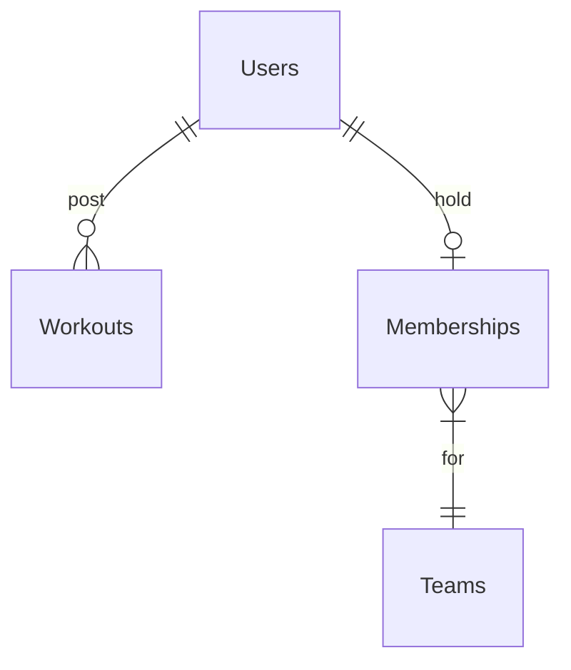

# Momentum
#### Video Demo:  [Momentum - CS50x Project](https://youtu.be/-nsr6j7vZ9M)
#### Description: A fitness site designed for the user to derive energy from their team's momentum.

## Momentum.db

### Overview
The underlying database enables three core functions of the application:
+ The `Users` table supports user sessions by storing the user's id, which is passed as the key in the sessions dictionary.
+ The `Workouts` table stores users' posts and is queried to display workout information on the `/progress` and `/team` pages.
+ The `Memberships` table stores the relationships between users in the `Users` table and teams in the `Teams` table. The query that displays items from the `Workouts` table on the `/team` page is filtered by a user's assigned team.

### Relationships

### Schema
#### Users
+ `Id` is an `INTEGER` value that stores the user's `PRIMARY KEY`. The value is set to `AUTOINCREMENT` and must be `NOT NULL`.
+ `Username` is a `TEXT` value that must be `UNIQUE` and `NOT NULL` so as to avoid duplicate usernames. 
+ `Hash` is a `TEXT` value that stores the has value of the user's password and must be `NOT NULL`.

#### Workouts
+ `Id` is an `INTEGER` value that stores the workout's `PRIMARY KEY`. The value is set to `AUTOINCREMENT` and must be `NOT NULL`.
+ `User_id` is an `INTEGER` value that `REFERENCES` the user associated with the workout via `users(id)`.
+ `Date` is a `DATE` value that must be `NOT NULL` as it is a required input on post form.
+ `Year` is an `INTEGER` value that is `NOT NULL` as it results from parsing `date`.
+ `Month` is an `INTEGER` value that is `NOT NULL` as it results from parsing `date`.
+ `Day` is an `INTEGER` value that is `NOT NULL` as it results from parsing `date`.
+ `Title` is a `TEXT` value that must be `NOT NULL` as it is a required input on the post form.
+ `Description` is a `TEXT` value that is an optional input on the post form.
+ `Image` is a `TEXT` value that stores the relative path of an image and is an optional input on the post form.

#### Teams
+ `Id` is an `INTEGER` value that stores team's `PRIMARY KEY`. The value is set to `AUTOINCREMENT` and must be `NOT NULL`.
+ `Name` is a `TEXT` value that must be `UNIQUE` and `NOT NULL` so as to avoid duplicate team names. 
+ `Join_code` is a `TEXT` value that must be `NOT NULL`.
+ `Creation_date` is a `DATE` value that is set to `DEFAULT` to the `CURRENT_DATE`.

#### Memberships
+ `Id` is an `INTEGER` value that stores membership's `PRIMARY KEY`. The value is set to `AUTOINCREMENT` and must be `NOT NULL`.
+ `Team_id` is an `INTEGER` value that `REFERENCES` the team associated with the membership via `teams(id)`. 
+ `User_id` is an `INTEGER` value that `REFERENCES` the user associated with the membership via `users(id)`.
+ `Join_date` is a `DATE` value that is set to `DEFAULT` to the `CURRENT_DATE`.

## App.py

### Sessions

#### Log In
When users do not have an active session, they are first redirected to the `/login` route. This page contains a link for new users to redirect to the `register` route, along with a log in form for existing users. When users submit their log in information, the `login` function validates that both the username exists, and that the username and passwoerd combination exists. If it does, the session's user is set and the user is redirected to the landing page. Otherwise, an error message is returned on the `/login` route.

#### Register
New users can register by navigating to `/register` through the navigation bar or the link on `/login`. Users are prompted to enter a username, a password, and a confimation of the password. When the request method is POST, the `register()` function gets the input, validates it, and tries to insert the information into the `Users` table. If an exception is raised due to the unique constraint on `username`, a message is returned on the `/register` page that says the username is already taken.

#### Log Out
Once the user is logged in, they have the option in the navbar to log out. This `logout()` function simply clears the session and redirects back to the landing page. Since a session is no longer active, the landing page then redirects the user to the `/login` route.

### Main Interface

#### Post
Users add their workouts to the underlying database via the form on `/posts`. The input from the form is validated in the `post()` function and then inserted into the workouts table, though an image and description are not required entries. Once added, the users can then view their workouts on the `/progress` page and, given that they are a member of a team, the `/team` page.   

#### Team 
As mentioned above, if users are already memebers of a team, the `/team` page will display a social feed of all teammembers' workouts in chronological order of workout date. However, if the `team()` function queries the `memberships` table and does not locate the user, it will redirect to the `/no_team` page where they can either join a team via the form on `/join` or create a team via the form on `/create`. Once the user submits either of these forms, they're then redirected to `/team` page where they will see the posts of every user with a membership to their team.

#### Progress
The user's workouts are not visualized on the `/progress` page in the same card-like format as in the team feed. Instead, the workouts are stacked in a chart.js bar chart that's categorized by month. Below the chart, the user's workouts are displayed in a table by date and title, which provides the opportunity to review their individual progress. 

### Limitations and Next Steps
This application has limitations that I aim to implement outside of the scope of CS50x, with the obvious ones being that user's currently cannot delete or edit their posts and that users are unable to leave or join additional teams. But beyond these, I'd like to implement a "Momentum" feature that scores a team's momentum through a simple trailing average function such as: 
    
    Momentum = SUM(Workout History) / (Lookback Days * COUNT(Users))

The goal of this feature would be to motivate behavior, just as streaks encourage users to engage in DuoLingo lessons. I believe the optimal value for the lookback period would be between 1 and 2 weeks, long enough to be meaningful, but also short enough to be forgiving. 
